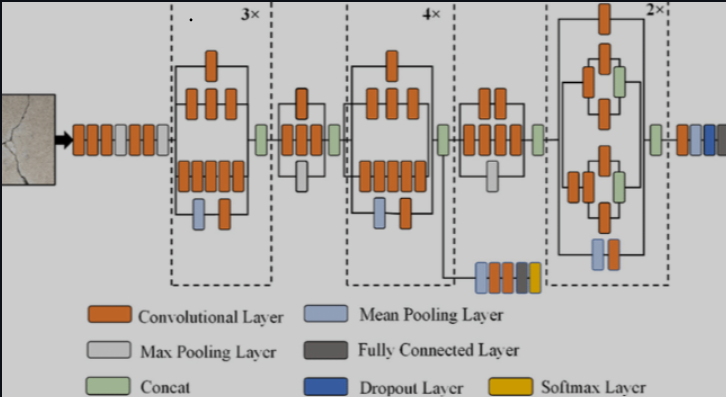

# AI Image Classifier

A Streamlit-powered image classification app that detects whether an uploaded image is likely real or AI-generated. The app allows users to upload an image from their local system and get a prediction with confidence scoring.

## About
We have built an AI-Image classifier app. This app successfully classifies images as real or AI-generated fake images. It also shows the p-scores of the classification with respect to the image being real. This feature retains transparency and provides important information about model confidence.

Images with borderline p-scores around 0.5 may indicate a blend between real and synthetic content. For example, tests on real images edited using AI features resulted in p-values in the range of approximately 0.6 to 0.8, suggesting that the image is primarily real but still contains some synthetic features. In contrast, purely real photographs typically show p-scores above 0.95.

This project uses a pretrained InceptionV3 model to classify images into two classes:
- Real
- Fake / AI-generated

The app also displays the probability score associated with the prediction, which helps interpret how confident the model is about the result.

## Architecture
We evaluated multiple pretrained image classification architectures and selected InceptionV3 for this task because of its strong performance on image recognition tasks, efficient architecture, and reduced parameter count compared to older deep CNN approaches.

### Why InceptionV3?
- Uses Inception modules for multi-scale feature extraction
- Improves feature learning across different spatial dimensions
- Reduces computational complexity while maintaining accuracy
- Works well for binary image classification tasks

### Model architecture overview



## Project workflow
1. Upload an image from the local machine.
2. The app preprocesses the image.
3. The model predicts whether the image is real or fake.
4. The result and probability score are displayed to the user.

## Demo video

Watch the demo here: https://drive.google.com/file/d/1HYEv4_ogIxTAKEBRDEhHX9nj9NOSscbx/view?usp=sharing

## How to run locally
### Requirements
- Python 3.9+
- Git
- A virtual environment is recommended

### Clone the repository
```bash
git clone https://github.com/lostinvsc/Ai_image_classifier.git
cd Ai_image_classifier
```

### Install dependencies
```bash
pip install -r requirements.txt
```

### Run the app
```bash
streamlit run app.py
```

Then open the local URL shown in the terminal.

## How to use the app
- Choose a theme: Light or Dark mode
- Upload an image from your local system
- Click the Produce Result button
- View whether the image is classified as Real or Fake and the assigned probability

## Project structure
- `app.py` — Streamlit UI
- `main.py` — model preprocessing and prediction logic
- `requirements.txt` — project dependencies
- `inceptionv3f.weights.h5` — trained model weights
- `Inception_architecture.png` — model architecture diagram

## Notes
- The app currently supports local image uploads only.
- The project is designed for image classification and can be extended with improved UI, model tuning, or additional evaluation metrics.

## Future improvements
- Improve model accuracy with more diverse datasets
- Add image preprocessing enhancements
- Add confidence visualization and result explanations
- Improve overall user interface and app experience

### Happy Contributing!!
